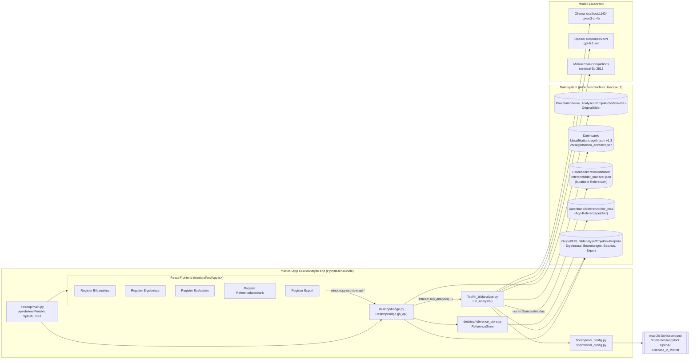
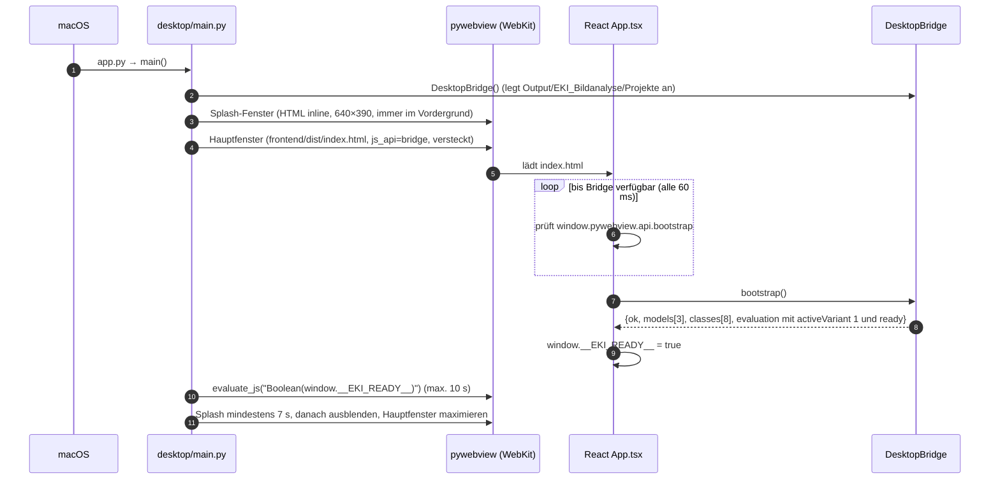
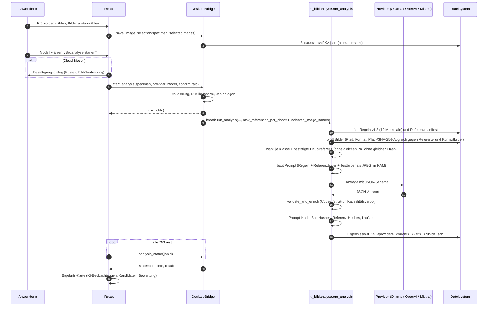
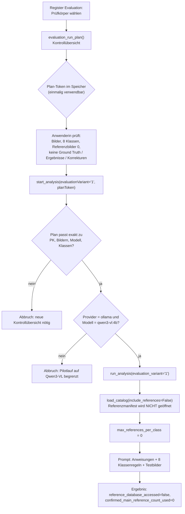
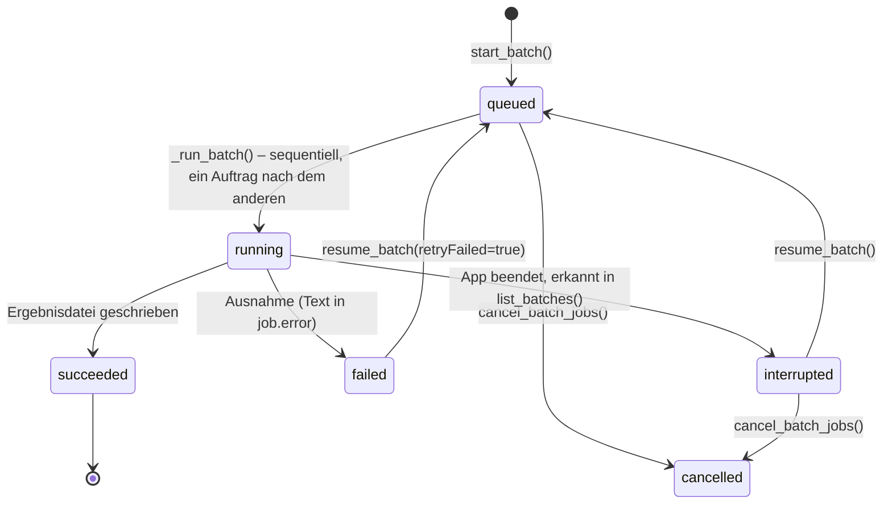
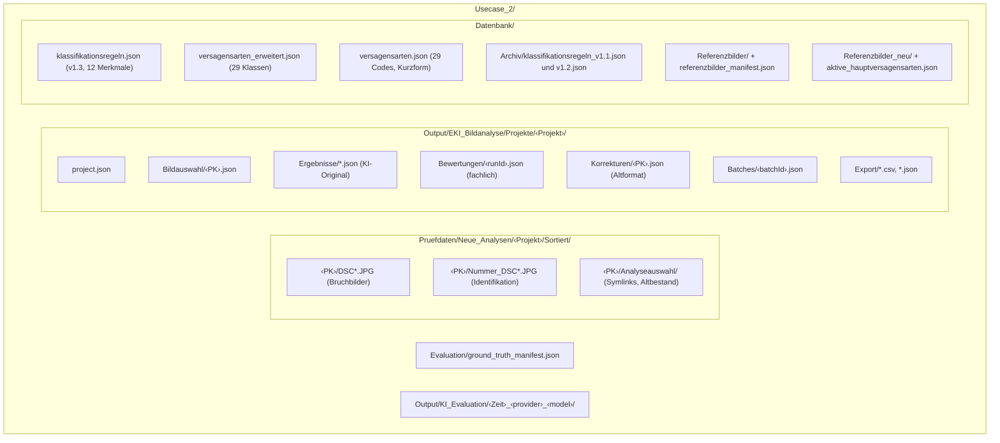

# Systemarchitektur – KI-Bildanalyse (Use Case 2)

**Stand der Analyse:** 26.10.2026 · Arbeitsstand des Projektverzeichnisses `Usecase_2/` inklusive nicht committeter Änderungen (siehe Abschnitt 8)
**Geltungsbereich:** Desktop-Anwendung „KI-Bildanalyse 1.0.0“ (`at.holzbauforschung.ki-bildanalyse`)

Dieses Dokument beschreibt die tatsächlich implementierte Architektur. Alle Aussagen beziehen sich auf den Quellcode; Dateiverweise sind relativ zum Projektverzeichnis angegeben.

---

## 1. Überblick

Die Anwendung ist eine native macOS-Desktop-Anwendung aus drei Schichten:

1. **Präsentationsschicht:** React-19-Oberfläche (TypeScript, gebaut mit Vite), ausgeliefert als statische Dateien aus `frontend/dist/`.
2. **Bridge- und Anwendungsschicht:** Python-Klasse `DesktopBridge` ([desktop/bridge.py](../desktop/bridge.py)), die über pywebview als JavaScript-API bereitgestellt wird. Sie verwaltet Projekte, Bildauswahl, Aufträge, Bewertungen und Exporte.
3. **Fach- und Integrationsschicht:** Das Modul [Tool/ki_bildanalyse.py](../Tool/ki_bildanalyse.py) ist die einzige Klassifikationslogik. Es lädt Klassendefinitionen und Regeln, prüft die Bilder, erzeugt den Prompt, ruft das Modell auf, validiert die Antwort und schreibt die Ergebnisdatei. Ergänzend gibt es den Referenzbildspeicher [desktop/reference_store.py](../desktop/reference_store.py), das Evaluationswerkzeug [Tool/evaluation.py](../Tool/evaluation.py) (nur Kommandozeile) und das Sortierwerkzeug [Tool/bildzuordnung_neue_analysen.py](../Tool/bildzuordnung_neue_analysen.py) (nur Kommandozeile).

Die Modellanbieter sind über austauschbare Funktionen angebunden:

| Anbieter | Laufzeit/Schnittstelle | Modellkennung im Code | Ort der Verarbeitung |
|---|---|---|---|
| Ollama (lokale Laufzeitumgebung) | HTTP `POST http://localhost:11434/api/chat` | `qwen3-vl:4b` | lokal auf dem Mac |
| OpenAI | Python-SDK `openai`, Responses-API | `gpt-6.1-sol` | Cloud |
| Mistral | HTTPS `POST https://api.mistral.ai/v1/chat/completions` (direkt über `urllib`) | `ministral-3b-2512` | Cloud |

Quelle: `MODEL_CONFIGS` in [desktop/bridge.py:44-48](../desktop/bridge.py#L44-L48), Konstanten in [Tool/ki_bildanalyse.py:59-66](../Tool/ki_bildanalyse.py#L59-L66), `modelChoices` in [frontend/src/App.tsx:14-18](../frontend/src/App.tsx#L14-L18).

---

## 2. Komponentendiagramm

**Hinweis zum Bundle:** Im gebauten App-Bundle werden `klassifikationsregeln.json`, `versagensarten_erweitert.json`, das kuratierte Referenzmanifest samt 26 Hauptreferenzbildern und die Modellverifikationsdateien **aus dem Bundle** gelesen (Ressourcenliste in [KI-Bildanalyse.spec](../KI-Bildanalyse.spec)). Projektdaten, Prüfbilder, `Referenzbilder_neu/` und Ergebnisse liegen dagegen im Arbeitsverzeichnis, das `_workspace_root()` ermittelt ([desktop/bridge.py:26-38](../desktop/bridge.py#L26-L38)): Umgebungsvariable `EKI_PROJECT_ROOT`, sonst Quellverzeichnis, sonst `~/Desktop/Masterarbeit/Usecase_2` (jeweils nur, wenn dort ein Ordner `Pruefdaten` existiert). Änderungen an den Regeldateien wirken in der installierten App daher erst nach einem Neubau. Zum Analysezeitpunkt waren die SHA-256-Werte der Regeldateien in Projekt und `/Applications/KI-Bildanalyse.app` identisch.

---

## 3. Start der Anwendung und Kommunikation React ↔ Python

Die Kommunikation folgt einem einheitlichen Muster: Das Frontend ruft `window.pywebview.api.<methode>(payload)` über die Hilfsfunktion `api()` auf ([frontend/src/App.tsx:20](../frontend/src/App.tsx#L20)). Jede Bridge-Methode gibt ein Dictionary mit `ok: true|false` und bei Fehlern `error` zurück; das Frontend zeigt Fehler als Hinweis-Toast an. Lang laufende Analysen werden in Python-Threads ausgeführt; das Frontend fragt den Status zyklisch ab (Einzelanalyse alle 750 ms, Batch jeden 1 s).

### Öffentliche Bridge-Methoden

| Methode | Zweck | Aus der Oberfläche aufgerufen |
|---|---|---|
| `bootstrap` | Modelle, aktive Klassen, Status Variante 1 | ja |
| `open_example`, `choose_project`, `create_project` | Projekt öffnen/anlegen | ja |
| `project_snapshot`, `specimen_detail`, `create_specimen`, `import_images` | Prüfkörper und Bilder | ja |
| `save_image_selection` | manuelle Bildauswahl speichern | ja |
| `start_analysis`, `analysis_status` | Einzelanalyse (Thread) | ja |
| `plan_batch`, `start_batch`, `batch_status`, `list_batches`, `cancel_batch_jobs`, `resume_batch` | Batch-Aufträge | ja |
| `project_results`, `result_detail`, `save_assessment` | Ergebnisse und Expertenreview | ja |
| `evaluation_overview`, `evaluation_run_plan` | Variante 1, Kontrollübersicht | ja |
| `reference_catalog`, `choose_reference_images`, `update_reference_entry` | Referenzspeicher | ja |
| `export_selected_runs` | Export ausgewählter Läufe | ja |
| `save_correction`, `export_overview`, `export_run`, `export_comparison`, `export_specimen`, `import_reference_images`, `save_active_reference_codes`, `open_project_path` | ältere bzw. interne Funktionen | **nein** (im aktuellen `App.tsx` nicht verwendet) |

---

## 4. Datenfluss einer Einzelanalyse (Standardmodus)

### Variante 1 (referenzfrei) – Abweichungen vom Standardmodus

Quelle: [desktop/bridge.py:388-439](../desktop/bridge.py#L388-L439), [desktop/bridge.py:629-655](../desktop/bridge.py#L629-L655), [Tool/ki_bildanalyse.py:1224-1244](../Tool/ki_bildanalyse.py#L1224-L1244).

---

## 5. Datenfluss vom Rohbild zum Ergebnis

```mermaid
flowchart LR
  RAW["Rohfotos einer Serie<br/>(Kamera, chronologisch)"] --> SORT["Tool/bildzuordnung_neue_analysen.py<br/>(CLI, lokale OCR der Nummernfotos)"]
  SORT --> SORTED["Sortiert/‹PK›/<br/>Kopien, Nummernfotos mit Präfix Nummer_"]
  SORT --> REV["Sortiert/Zur_Pruefung/<br/>unklare Zuordnungen"]
  IMP["App: „Bilder hinzufügen“<br/>(Kopie mit shutil.copy2)"] --> SORTED
  SORTED --> GAL["Galerie (Vorschau-JPEG 720 px, nur Anzeige)"]
  GAL --> SEL["Bildauswahl/‹PK›.json<br/>Vorauswahl ≤ 3 verteilte Bilder"]
  SEL --> CHK["collect_test_images()<br/>Formatprüfung, Leakage-Prüfung (Pfad + SHA-256)"]
  CHK --> RAM["JPEG-Kopie im Arbeitsspeicher<br/>OpenAI/Mistral ≤ 2048 px, Ollama ≤ 768 px"]
  RAM --> MOD["Modellaufruf"]
  MOD --> VAL["validate_and_enrich()"]
  VAL --> RES["Ergebnis-JSON (Schema 2.0)<br/>inkl. SHA-256 der Originaldateien"]
  RES --> REV2["Expertenreview<br/>Bewertungen/‹runId›.json (getrennt)"]
  RES --> EXP["Export CSV + JSON"]
  REV2 --> EXP
```

Die Originalbilder werden von der Analyse ausschließlich gelesen. Neue Dateien entstehen nur beim Import (Kopie) und bei der Sortierung (Kopie bzw. symbolische Links im Ordner `Analyseauswahl`).

---

## 6. Batch-Verarbeitung

Jeder Batch wird nach jeder Zustandsänderung als `Batches/<batchId>.json` gespeichert (temporäre Datei, dann `replace`). Batches laufen **immer im Standardmodus** (mit einer Referenz je Klasse); eine Evaluationsvariante wird im Batch nicht übergeben ([desktop/bridge.py:892-909](../desktop/bridge.py#L892-L909)). Cloud-Aufträge benötigen eine gemeinsame Freigabe mit der angezeigten Zahl geplanter Cloud-Anfragen; bei Mistral wird je ausgewähltem Bild eine Anfrage geplant ([desktop/bridge.py:783](../desktop/bridge.py#L783)).

---

## 7. Datenablage

---

## 8. Komponentensteckbriefe

### 8.1 Desktop-Hülle – `desktop/main.py`

| Aspekt | Beschreibung |
|---|---|
| Aufgabe | Startet pywebview mit Splash- und Hauptfenster, wartet auf React-Bereitschaft, findet Ressourcen im Bundle oder Quellbaum |
| Dateien | [app.py](../app.py), [desktop/main.py](../desktop/main.py) |
| Eingaben | optional `--dev-url` oder `EKI_FRONTEND_URL` (Vite-Entwicklungsserver), `EKI_WEB_DEBUG` |
| Ausgaben | Fenster; Warnungen auf `stderr`, falls React nicht innerhalb von 10 s bereit ist |
| Abhängigkeiten | `pywebview>=6.1`, `assets/widget.png`, `frontend/dist/index.html` |

### 8.2 Frontend – `frontend/src/App.tsx`

| Aspekt | Beschreibung |
|---|---|
| Aufgabe | gesamte Bedienoberfläche in einer Komponente; fünf Register; Ergebniskarte `RunCard` |
| Dateien | [frontend/src/App.tsx](../frontend/src/App.tsx), `main.tsx`, CSS-Dateien `styles.css`, `analysis-image.css`, `comparison.css`, `workspace-tabs.css` |
| Eingaben | Antworten der Bridge-Methoden |
| Ausgaben | Bridge-Aufrufe mit JSON-Payload |
| Abhängigkeiten | React 19.3.1, Vite 8.3.5, TypeScript 7.0.2, @vitejs/plugin-react 6.1.2 (installierte Versionen laut `node_modules`; `package.json` verlangt jeweils `latest`, die Versionen sind über `package-lock.json` fixiert) |

### 8.3 Bridge – `desktop/bridge.py`

| Aspekt | Beschreibung |
|---|---|
| Aufgabe | Projekt-, Bild-, Auftrags-, Bewertungs- und Exportverwaltung; Freigabeprüfungen (Kosten, Kontrollübersicht, Duplikatsperre) |
| Eingaben | Payload-Dictionaries aus dem Frontend; Dateien unter `Pruefdaten/` |
| Ausgaben | JSON- und CSV-Dateien unter `Output/EKI_Bildanalyse/Projekte/<Projekt>/` |
| Abhängigkeiten | `Tool.ki_bildanalyse` (`run_analysis`, `load_catalog`, `SUPPORTED_SUFFIXES`), `desktop.reference_store`, Pillow, `threading` |

### 8.4 Klassifikationskern – `Tool/ki_bildanalyse.py`

| Aspekt | Beschreibung |
|---|---|
| Aufgabe | Katalog laden und validieren, Bilder prüfen, Referenzen wählen, Prompt bauen, Provider aufrufen, Antwort validieren, Ergebnisdokument schreiben; zusätzlich CLI |
| Eingaben | Prüfkörperordner, Bildauswahl, Provider/Modell, Optionen (Kontext, Bildkante, Referenzanzahl, Variante) |
| Ausgaben | Ergebnisdatei (Schema 2.0) |
| Abhängigkeiten | Pillow, `openai`-SDK (nur OpenAI), `urllib` (Ollama, Mistral), [Tool/openai_config.py](../Tool/openai_config.py), [Tool/mistral_config.py](../Tool/mistral_config.py), `Datenbank/*.json`, [Tool/model_verification.json](../Tool/model_verification.json), [Tool/mistral_model_verification.json](../Tool/mistral_model_verification.json), [Tool/mock_response.json](../Tool/mock_response.json) |

### 8.5 Referenzspeicher – `desktop/reference_store.py`

| Aspekt | Beschreibung |
|---|---|
| Aufgabe | Verwaltung von Referenzbildern unter `Datenbank/Referenzbilder_neu/` mit Klasse, Prüfkörper-ID, Anmerkung, Bestätigungsstatus und SHA-256 |
| Eingaben | Bildpfade aus dem Dateidialog, Metadaten aus der Oberfläche |
| Ausgaben | `referenzbilder_manifest.json` (wird erst beim ersten Import/Bearbeiten angelegt), Bildkopien |
| Abhängigkeiten | Klassendefinitionen aus `load_catalog(include_references=False)`, Pillow |
| Abgrenzung | **Wird nicht als Modellinput verwendet.** Die Modelle erhalten Referenzbilder ausschließlich aus `Datenbank/Referenzbilder/referenzbilder_manifest.json`. |

### 8.6 Evaluationswerkzeug – `Tool/evaluation.py` (CLI)

| Aspekt | Beschreibung |
|---|---|
| Aufgabe | Ground Truth aus bestätigten Hauptreferenzen erzeugen; Leave-one-Prüfkörper-out-Läufe der Varianten A–D planen und optional ausführen; Kennzahlen berechnen |
| Eingaben | `Evaluation/ground_truth_manifest.json`, kuratiertes Referenzmanifest |
| Ausgaben | `Output/KI_Evaluation/<Zeit>_<provider>_<model>/run_plan.json`, bei `--execute` zusätzlich `evaluation_results.json/.csv`, `confusion_matrices.csv` |
| Abhängigkeiten | Funktionen aus `Tool.ki_bildanalyse` |

### 8.7 Sortierwerkzeug – `Tool/bildzuordnung_neue_analysen.py` (CLI)

| Aspekt | Beschreibung |
|---|---|
| Aufgabe | Ordnet unsortierte Fotos einer neuen Serie anhand lokal per OCR erkannter Nummernfotos Prüfkörpern zu |
| Eingaben | Ordner mit Originalbildern (EXIF-Zeit erforderlich) |
| Ausgaben | `Sortiert/<PK>/` (Kopien), `Sortiert/Zur_Pruefung/`, `Bildzuordnung.csv`, `Sortierprotokoll.json`, `Analyseauswahl/` (Symlinks) |
| Abhängigkeiten | lädt OCR-, EXIF- und Farbanalysefunktionen aus `Datenbank/Alte_Versuche/Zugversuch 2/bildzuordnung_serien.py`; die Seriennummer `Z-30` ist im regulären Ausdruck fest codiert |

---

## 9. Fehlerbehandlung (Architekturebene)

| Ebene | Mechanismus | Quelle |
|---|---|---|
| Frontend | `try/catch` um Bridge-Aufrufe, Fehler-Toast, Statuszeile | [App.tsx:74-77](../frontend/src/App.tsx#L74-L77) |
| Bridge | Rückgabe `{ok:false, error}` statt Ausnahme; Worker-Thread fängt jede Ausnahme und setzt `state="error"` bzw. `status="failed"` | [bridge.py:734-740](../desktop/bridge.py#L734-L740), [bridge.py:918-926](../desktop/bridge.py#L918-L926) |
| Kern | `AnalysisError` für Eingabe-, Daten- und Antwortfehler; providerspezifische Fehler ohne Schlüssel- und Bildinhalte | [ki_bildanalyse.py:78](../Tool/ki_bildanalyse.py#L78), [mistral_config.py](../Tool/mistral_config.py) |
| Ollama | Zeitüberschreitung nach 900 s, HTTP-Fehler mit gekürztem Body, nicht erreichbarer Dienst, unlesbares JSON mit Diagnosewerten | [ki_bildanalyse.py:894-934](../Tool/ki_bildanalyse.py#L894-L934) |
| Persistenz | atomare Schreibvorgänge (temporäre Datei + `os.replace`) für Bildauswahl, Batches und Referenzmanifest; Ergebnis- und Bewertungsdateien werden direkt geschrieben | [bridge.py:140-162](../desktop/bridge.py#L140-L162) |

Eine automatische Wiederholung fehlgeschlagener Modellaufrufe ist nicht implementiert; im Batch kann die Anwenderin fehlgeschlagene Aufträge ausdrücklich erneut einreihen.

---

## 10. Versionsstand des Quellcodes

Die Git-Historie endet mit dem Commit `0504645` („Stabile Bildanalyse vor Evaluationserweiterung“). Die Umstellung auf Regelversion 1.2 mit acht Klassen, Promptversion `3.1-eight-class-visual-only`, Evaluationsvariante 1, der neue Referenzspeicher und die zugehörigen Tests liegen zum Analysezeitpunkt **als nicht committete Änderungen** im Arbeitsverzeichnis vor (`git status`: 14 geänderte, 6 neue Pfade). Für die wissenschaftliche Reproduzierbarkeit sollte dieser Stand versioniert werden, bevor Evaluationsläufe durchgeführt werden, da der Prompt-Hash vom Code abhängt.
